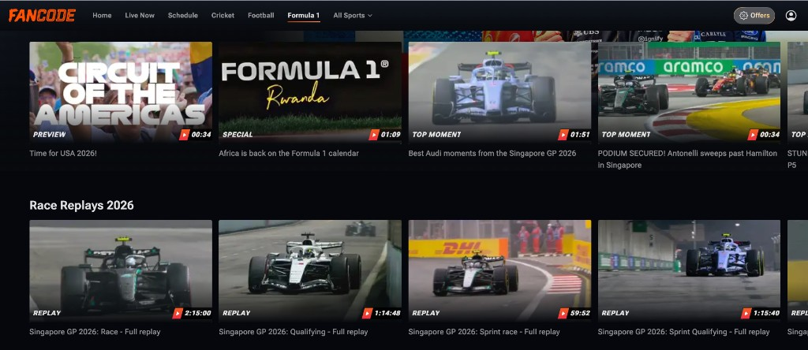
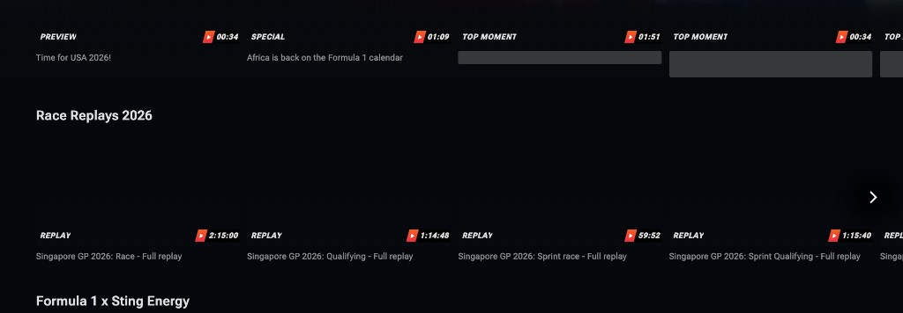

# Replay Guard

A tiny Chrome extension for watching **Formula 1 replays on [FanCode](https://www.fancode.com/formula1) without spoilers**.

Missed the race and want to watch the replay later? FanCode's F1 page puts the result right in front of you: highlight thumbnails of the winner's car, titles like *"PODIUM SECURED! … sweeps past … in Singapore"*, and "continue watching" that drops you into the middle of the race. Replay Guard fixes that:

- 🖼️ **Hides every thumbnail** on FanCode F1 pages.
- 🏷️ **Hides spoiler titles, keeps useful ones.** *"Singapore GP 2026: Race - Full replay"* stays readable so you can find the race; *"Antonelli sweeps past Hamilton"* turns into a grey bar.
- ⏮️ **Starts every video from the beginning**, even if FanCode tries to resume where you left off.
- 🔇 **Leaves the rest of FanCode alone.** Cricket, football and everything else look and behave normally.

No account, no settings, no tracking. Install it and open the F1 page.

## Before vs after

| Before | After |
| --- | --- |
|  |  |

In the after screenshot:
- the two "TOP MOMENT" titles (which named the podium) are replaced by grey bars;
- "Time for USA 2026!", "Africa is back on the Formula 1 calendar" and every "… - Full replay" title stay visible;
- all thumbnails are gone, while the labels (REPLAY, PREVIEW) and durations remain.

## Install

Replay Guard is not on the Chrome Web Store yet, so you load it from source. It takes about a minute.

**Prerequisites:** [Node.js](https://nodejs.org/) 24 or newer, plus Google Chrome (or any Chromium browser such as Edge, Brave or Arc).

```sh
git clone https://github.com/import-keshav/replay-guard.git
cd replay-guard
npm install
npm run build
```

Then load it into Chrome:

1. Open `chrome://extensions`.
2. Turn on **Developer mode** (top right).
3. Click **Load unpacked** and pick the `dist/` folder inside `replay-guard`.
4. Open (or reload) <https://www.fancode.com/formula1>.

To update later, run `git pull && npm run build`, then press the reload ↻ button on the extension card in `chrome://extensions`.

## How it works

Everything runs inside the FanCode page, in a single content script (`src/content.ts`). The rules live in one small file (`src/rules.ts`).

### Which pages

Only FanCode F1 pages are touched:

| Path | Example |
| --- | --- |
| `/formula1/…` | F1 home, Grand Prix schedules, session pages |
| `/formula-1/…` | highlight videos |
| `/tour-listing/formula1` | list of all Grands Prix |

FanCode is a single-page app, so the extension notices when you move between F1 and other sports without a page reload, and switches on and off accordingly.

### Thumbnails

While you are on an F1 page, every ``, `<picture>` and element with an inline `background-image` is hidden with CSS. The CSS is injected before the page paints, so thumbnails don't flash on load.

### Spoiler titles

Every piece of text that appears on the page (including content loaded later as you scroll) is checked against three word lists:

| List | Examples |
| --- | --- |
| Drivers (surnames and distinctive first names) | Verstappen, Hamilton, Norris, Piastri, Antonelli, Max, Lando, Kimi |
| Teams | Red Bull, Ferrari, Mercedes, McLaren, Audi, Cadillac |
| Result words | win, won, podium, pole, P1–P20, overtake, passes, crash, DNF, penalty, champion, dominant, post-race, press conference, hails, admits |

If a text matches, its element gets a grey bar instead of readable text. Matching is case-insensitive and whole-word only, so "Maximum", "Passport" or "Leadership" are not caught. A spoiler in the browser tab title is replaced with "FanCode".

Session replay titles never contain these words, so they stay readable:

```text
Singapore GP 2026: Race - Full replay                  → visible
Singapore GP 2026: Qualifying - Full replay            → visible
PODIUM SECURED! Antonelli sweeps past Hamilton …       → hidden
Max Verstappen hails Red Bull's turnaround after …     → hidden
Singapore GP 2026 post-race drivers press conference   → hidden
```

### Start from the beginning

The first time a video starts playing, Replay Guard checks where it is:

- **Replays / on-demand videos:** if playback is more than a second past the start (for example, FanCode resumed a half-watched race), it jumps back to the beginning.
- **Live streams:** it jumps to the oldest point FanCode allows you to rewind to, but only if FanCode keeps a rewind window of at least 30 seconds. With no rewind window there is no "start" to go to, so the stream plays live. The rewind window is logged to the DevTools console as `[replay-guard] live stream, seekable window: …`.

This happens only once per video. After that, seeking, pausing and skipping are entirely up to you.

## Privacy

- **No permissions.** The extension only declares a content script for `fancode.com`. It cannot read other sites, your tabs or your history.
- **No network requests, no analytics, no storage.** Nothing leaves your browser.
- **The only thing it changes** on the page is CSS visibility and the video's playback position.

## Known limitations

- **Keyword-based spoiler detection.** A spoiler phrased without any of the listed words (for example "What a day for the Silver Arrows!") is not caught. The driver list also has to be updated when the grid changes.
- **Some thumbnails can slip through.** Images that the site paints through CSS classes (rather than `` or an inline style) are not hidden.
- **Late resume.** If FanCode restores a saved position *after* the video has already started playing, that position wins.
- **Live streams can only rewind as far as FanCode allows.** If the rewind window is shorter than the time since the session started, you land at the oldest available point, not lights out.
- **Desktop Chrome / Chromium only, FanCode only.** F1 TV and other services are not supported.

If you hit a spoiler that got through, please [open an issue](https://github.com/import-keshav/replay-guard/issues) with the title text (or the URL of the page).

## Customising

To add or remove words, edit the `DRIVERS`, `TEAMS` or `RESULTS` arrays in [`src/rules.ts`](src/rules.ts), then run `npm run build` and reload the extension. Each entry is a regular expression fragment, e.g. `'h[uü]lkenberg'` or `'p\\d{1,2}'`.

## Development

```sh
npm install
npm test           # unit tests (Node's built-in test runner, runs the TypeScript directly)
npm run typecheck  # tsc --noEmit
npm run build      # bundles src/ into dist/ with esbuild
npm run package    # build + zip dist/ into replay-guard.zip
```

```text
manifest.json        Chrome MV3 manifest: one content script on fancode.com, no permissions
src/rules.ts         pure logic: which pages, which titles are spoilers, where a video should start
src/content.ts       applies the rules to the page (text scanning, SPA route changes, video start)
src/content.css      hides thumbnails and draws grey bars over spoiler text
test/rules.test.mjs  tests built from real FanCode titles
scripts/build.mjs    esbuild bundle into dist/
```

## Disclaimer

Replay Guard is an independent hobby project. It is not affiliated with, endorsed by, or connected to FanCode, Formula 1, the FIA or any team. All trademarks belong to their owners.
