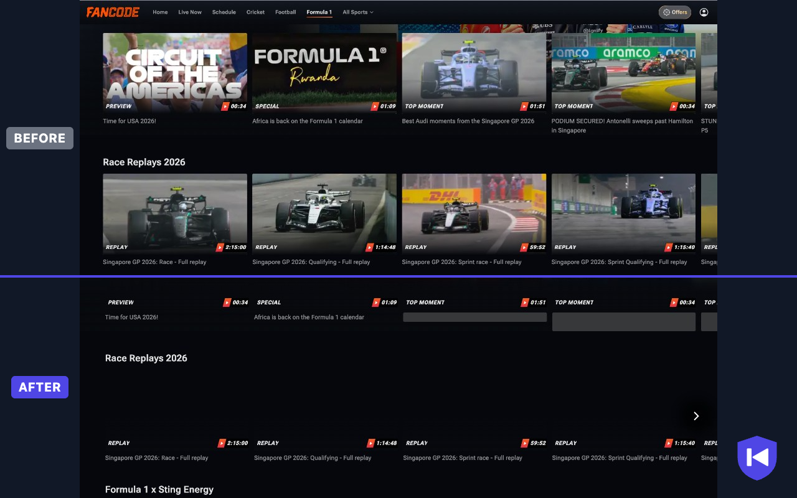

# Replay Guard

Watch **Formula 1 replays on [FanCode](https://www.fancode.com/formula1) without spoilers.**

FanCode's F1 page shows the result before you press play: thumbnails of the winning car, titles like *"PODIUM SECURED! … sweeps past …"*, and replays that resume in the middle of the race. Replay Guard is a small Chrome extension that fixes this. It has no settings: install it and open the F1 page.



## What it does

On FanCode's F1 pages it:

1. **Hides every thumbnail.**
2. **Greys out spoiler titles and keeps the useful ones.** "Singapore GP 2026: Race - Full replay" stays readable, so you can find the race. "Antonelli sweeps past Hamilton" becomes a grey bar.
3. **Starts every video from the beginning**, even if FanCode tries to resume where you left off.

The rest of FanCode (cricket, football and so on) is not touched.

## Install

The extension is not on the Chrome Web Store yet, so you load it from source. You need [Node.js](https://nodejs.org/) 24 or newer and Chrome (or another Chromium browser such as Edge, Brave or Arc).

```sh
git clone https://github.com/import-keshav/replay-guard.git
cd replay-guard
npm install
npm run build
```

Then load it into Chrome:

1. Open `chrome://extensions`.
2. Turn on **Developer mode** (top right).
3. Click **Load unpacked** and choose the `dist/` folder.
4. Open <https://www.fancode.com/formula1>.

To update later, run `git pull && npm run build`, then click the reload button (↻) on the extension's card in `chrome://extensions`.

## How it works

### Spoiler titles

Every piece of text on the page, including text loaded later as you scroll, is checked against three lists. Text that matches gets a grey bar instead.

| List | What's in it |
| --- | --- |
| Drivers | First name and surname of every driver this season, plus nicknames such as Alex, Ollie and Checo. "Max wins" is caught just like "Verstappen wins". |
| Teams | Red Bull, Ferrari, Mercedes, McLaren, Aston Martin, Williams, Audi, Cadillac and the rest of the grid |
| Result words | win, podium, pole, P1–P20, overtake, crash, DNF, penalty, champion, post-race, press conference, … |

Matching ignores case and accents ("Perez" matches "Pérez"), and only whole words count, so "Maximum" or "Passport" are left alone. A spoiler in the tab title is replaced with "FanCode".

Some examples:

```text
Singapore GP 2026: Race - Full replay                  → visible
PODIUM SECURED! Antonelli sweeps past Hamilton …       → hidden
Max Verstappen hails Red Bull's turnaround after …     → hidden
Singapore GP 2026 post-race drivers press conference   → hidden
```

**The driver list updates itself.** Once a day, the extension downloads this season's drivers from the free [Jolpica F1 API](https://github.com/jolpica/jolpica-f1). The list includes mid-season replacements and practice-session rookies. A built-in copy of the 2026 grid covers you until the download finishes, and also when you're offline or the API is down.

### Thumbnails

Images are hidden with CSS that loads before the page draws, so thumbnails never flash on screen.

### Starting from the beginning

The first time a video plays, the extension checks where it is:

- **Replays:** if it starts past the beginning, it jumps back to 0:00.
- **Live streams:** it jumps back as far as FanCode allows you to rewind. If the stream can't be rewound, it plays live.

After that first jump, pausing and seeking are up to you.

## Privacy

- It runs only on `fancode.com`.
- It uses one permission, `storage`, to remember the driver list for a day.
- It makes one network request a day, to `api.jolpi.ca`, to download the public driver list. Nothing about you or what you watch is sent.
- No analytics, no tracking.

Full details: [privacy policy](PRIVACY.md).

## Known limitations

- Detection is keyword-based. A spoiler that uses none of the listed words (for example "What a day for the Silver Arrows!") gets through.
- Because every driver's first name counts, an unrelated "George" or "Oliver" on an F1 page is hidden too.
- Thumbnails drawn as CSS background images by the site's stylesheets are not hidden.
- A live stream can only rewind as far as FanCode allows, which may not reach the start of the session.
- Works with FanCode in desktop Chrome and other Chromium browsers. Other streaming services, such as F1 TV, are not supported.

Found a spoiler that slipped through? [Open an issue](https://github.com/import-keshav/replay-guard/issues) with the title text.

## Development

```sh
npm test           # unit tests
npm run typecheck  # TypeScript check
npm run build      # build the extension into dist/
npm run package    # build and zip it into replay-guard.zip for the Chrome Web Store
```

| Path | What it is |
| --- | --- |
| `src/rules.ts` | Which pages count, which words are spoilers, where a video should start. Edit the word lists here. |
| `src/content.ts` | Runs on the page: scans text, loads the driver list, rewinds videos |
| `src/content.css` | Hides thumbnails and draws the grey bars |
| `test/rules.test.mjs` | Tests built from real FanCode titles |
| `manifest.json` | Chrome extension manifest |
| `icons/`, `store/` | Extension icons, Chrome Web Store screenshot, promo tile and listing text |
| `PRIVACY.md` | Privacy policy |

## Disclaimer

Replay Guard is an independent hobby project. It is not affiliated with or endorsed by FanCode, Formula 1, the FIA or any team. All trademarks belong to their owners.
